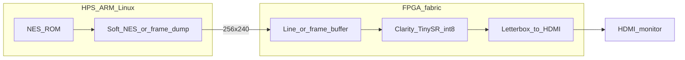

# Lab board: Terasic DE10-Nano (replaceable)

DE10-Nano is our **first FPGA lab board**, not the final product chassis.

Product goals (8/16-bit, maximum clarity, optional regeneration) live in [VISION.md](VISION.md).  
If this board is too small for Regen / 4K60 / multi-core, we **change hardware** — algorithms stay on PC as the golden reference.

Buy later — nothing in this repo requires the board yet: [Terasic DE10-Nano](https://www.terasic.com.tw/cgi-bin/page/archive.pl?Language=English&No=1046).

## What it is good for

| Feature | Fits |
|---|---|
| Cyclone V SoC + ARM | Soft NES / frame feed on HPS |
| ~110K LEs, ~112 DSPs | **Clarity TinySR int8** (small CNN) → **~1080p** |
| HDMI TX | 1080p-class output (primary; not 4K) |
| Cheap / well documented | Learn SoC+HDMI before spending on a bigger kit |

## What it is *not* for

| Goal | On DE10-Nano? |
|---|---|
| Pure + Clarity TinySR @ ~60 Hz → **1080p** (8-bit) | Yes — primary lab goal |
| **Transformer** Regen/Clarity @ 60 Hz | No on this chip — PC research + distill/hybrid ([AI_FPGA_PATH.md](AI_FPGA_PATH.md)) |
| Heavy **Regen** @ 60 Hz on fabric | No — PC/GPU or bigger FPGA / hybrid |
| **4K60** | Out of scope for this board (1080p is the product target) |
| DLSS | Never (NVIDIA-only) |

## Lab architecture



**Phase A:** Test pattern → nearest/bilinear → HDMI  
**Phase B:** TinySR int8 Clarity → HDMI  
**Phase C:** Live SoftNES → TinySR → HDMI @ 60 Hz  

PC `4kscaler --scale tinysr` remains bit-accurate golden reference.

## Shopping checklist (when you buy)

- [ ] DE10-Nano board + 5V PSU  
- [ ] MicroSD (Linux / GHRD)  
- [ ] HDMI cable + monitor  
- [ ] Host PC: Quartus Prime **Lite** + Terasic GHRD  

## Repo scaffold

```
fpga/de10_nano/
  README.md
  notes/bringup.md
  rtl/                # future SystemVerilog
  hps/                # future ARM feeder
```

## If we outgrow DE10-Nano

Do **not** force Regen onto this chip. Options:

1. **Bigger SoC FPGA** (Zynq UltraScale+, larger Intel SoC, etc.) — see [VISION.md](VISION.md)  
2. **Hybrid:** DE10 (or any FPGA) does capture/HDMI/low-latency Clarity; PC/NPU does Regen  
3. **PC appliance first** for Regen quality; FPGA later only for the parts that need fixed latency  

Decision gate: after Clarity TinySR runs well on DE10 *and* we know Regen model size / fps on PC.
