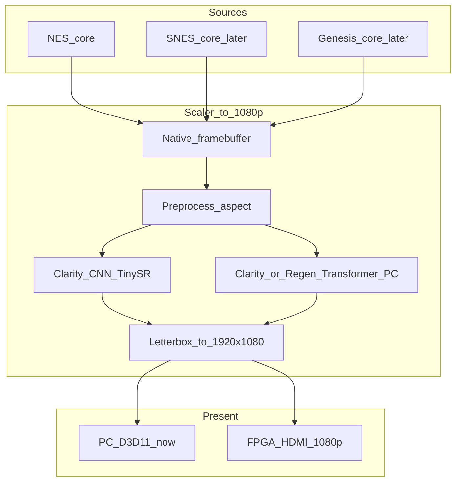

# Product vision: maximum-clarity retro scaler

## North star

Build a **powerful realtime scaler** for classic **8-bit and 16-bit** games that prioritizes:

1. **Clarity** — crisp pixels, clean edges, correct aspect, minimal mush/ringing  
2. **Fidelity modes** — preserve the original look when the user wants “authentic”  
3. **Regeneration (optional)** — AI that can *infer* plausible detail (CNN now; **transformers** on PC for quality research)  
4. **Portable path** — algorithms we own so they can move PC → FPGA → stronger FPGA if needed  

This is **not** locked to NES forever, and **not** locked to DE10-Nano forever.

## Output target

| Target | Priority |
|---|---|
| **4K60** (3840×2160), aspect-correct letterbox | **Primary quality goal** — [BEST_UPSCALE.md](BEST_UPSCALE.md) |
| 1080p60 / 1440p60 | Lighter PC / FPGA lab |
| Soft stretch without integer scale | Avoid for Clarity |

Native frames use **max uniform integer scale** into the canvas (e.g. NES @ 4K → **9×** = 2304×2160), then letterbox — not “4× then blur up”.

## Content targets

| Generation | Examples | Native sizes (typical) | Notes |
|---|---|---|---|
| 8-bit | NES, Master System, GB/GBC | ~160–256 × 144–240 | Current PC prototype: NES |
| 16-bit | SNES, Mega Drive/Genesis, PCE | ~256–512 × 224–240 | Next cores after NES Clarity is solid |
| Later | PS1-era / arcade (optional) | higher / odd | Only after 8/16 clarity pipeline is excellent |

One shared **video pipeline**; swap the emulator/core at the front.

## Quality modes (product)

| Mode | Intent | Tech direction |
|---|---|---|
| **Pure** | Maximum authenticity | Integer scale + optional CRT; no hallucinated detail |
| **Clarity** | Sharpest honest upscale | TinySR CNN family (FPGA-friendly); transformer variants on PC for A/B |
| **Regen** | Enhanced / reconstructed | Heavier nets — **transformer SR on PC first**; FPGA only if distilled/tiny |

“Regeneration” may invent detail. Toggle only — never forced.

## Transformers (how we think about them)

Transformers (windowed attention / Swin-style SR) are a strong candidate for **maximum clarity and Regen quality** on pixel art, but they are **much harder** on FPGA than small CNNs (attention, large buffers, irregular memory).

Strategy:

| Where | Role |
|---|---|
| **PC (now / research)** | Train & run transformer SR → 1080p; compare vs TinySR / NIS / DLSS |
| **FPGA lab (DE10)** | Keep **CNN TinySR** for realtime Clarity @ 1080p-class HDMI |
| **Later** | Distill transformer → small CNN/int8, **or** hybrid (FPGA I/O + NPU/GPU for transformer Regen) |

We do **think in transformers** for the quality ceiling; we do **not** assume a full ViT fits on DE10-Nano at 60 Hz.

See [AI_FPGA_PATH.md](AI_FPGA_PATH.md).

## System architecture (long term)

## Hardware strategy (flexible)

| Stage | Hardware | Role |
|---|---|---|
| **Now** | Windows PC + D3D11 | NES host; CNN + later transformer → **1080p** |
| **Lab FPGA** | [DE10-Nano](DE10_NANO.md) | CNN Clarity → HDMI ~1080p |
| **Prod / upgrade** | Larger SoC FPGA if needed | Headroom for 16-bit + heavier Clarity |
| **Hybrid** | FPGA video + NPU/GPU | Full **transformer Regen** at 1080p60 |

DE10-Nano is enough for lab CNN Clarity @ 1080p-class.  
Upgrade or hybrid when transformer Regen must run off-PC at 60 Hz.

**Rule:** algorithms stay board-agnostic. Hardware is replaceable.

## Success criteria

- **1080p** output looks excellent for 8-bit, then 16-bit  
- Clarity beats mushy upscales; Pure still available  
- Transformer Regen optional on PC; impressive when enabled  
- Playable latency (≈ emulator + 1–2 frames)  
- FPGA path proven with CNN; transformer path documented for distill/hybrid  

## Near-term focus

1. NES → **1080p** Clarity on PC (train TinySR)  
2. Prototype **transformer SR** on PC (quality ceiling / Regen)  
3. DE10-Nano CNN Clarity → HDMI  
4. 16-bit cores after NES Clarity feels strong  
5. Decide distill vs hybrid before buying a bigger FPGA for transformers  
